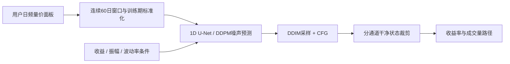
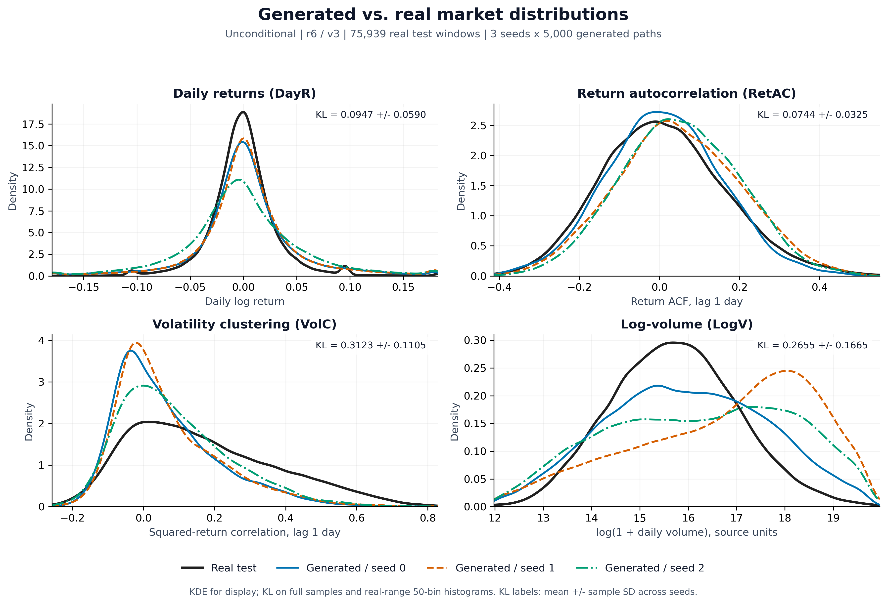
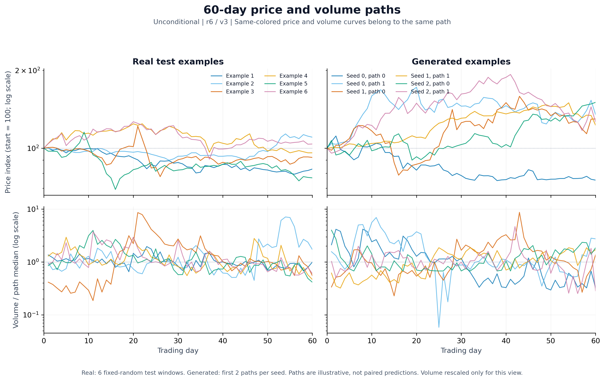
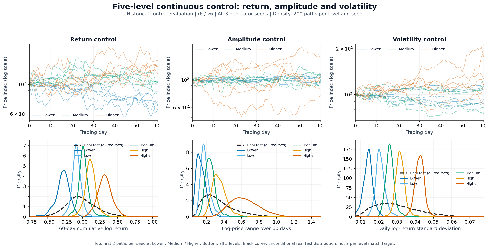
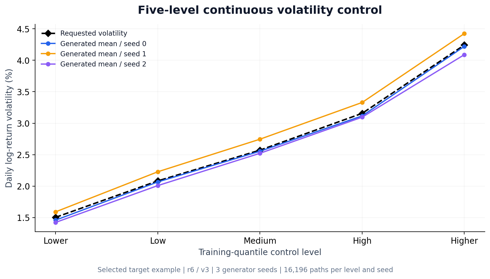
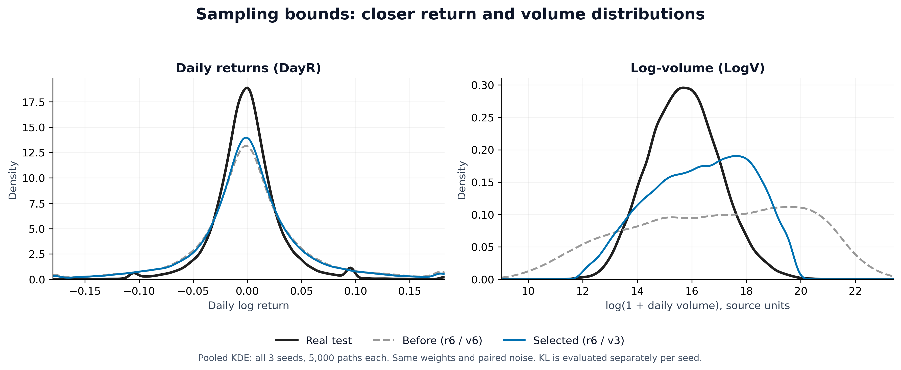
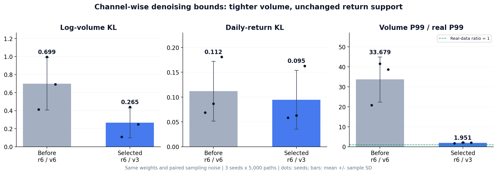

# DigMA-Diffusion-Daily

**基于 DigMA 扩散控制器的日频量价情景生成。** 学习历史股票量价分布，生成 **60 个交易日的收益率与成交量序列**，支持无条件、离散条件和连续条件三种方式。

*A daily-frequency adaptation of DigMA / TimeCraft's diffusion controller for controllable return–volume scenario generation.*

[](https://github.com/adrianelo0107/DigMA-Diffusion-Daily/actions/workflows/smoke.yml)


> 生成器代码固定于 **v0.1.0**，README 展示沿用已完成实验。默认使用 **对数成交量 + 收益裁剪 ±6 / 成交量裁剪 ±3**。仓库仅含源码、配置、文档及结果图片，**不提供原始行情、生成样本数组、模型权重或服务器配置**。

## 主要参考

Yu-Hao Huang, Chang Xu, Yang Liu, Weiqing Liu, Wu-Jun Li, Jiang Bian. **Controllable Financial Market Generation with Diffusion Guided Meta Agent**, AAAI 2026.

- [论文链接的扩展版本](https://arxiv.org/abs/2408.12991)
- [官方代码 Microsoft / TimeCraft](https://github.com/microsoft/TimeCraft)
- 参考提交：[`9a81eeef`](https://github.com/microsoft/TimeCraft/tree/9a81eeef4f8487353a4aedb0b80b8a534e765720/DiGA)

本项目复用其 **1D U-Net、条件编码、噪声预测目标与 CFG**，重点适配扩散模块。原论文生成日内市场状态并通过 Meta Agent 形成订单流；这里直接生成日频对数收益与 log1p 成交量，覆盖预处理、训练、采样和生成质量评估。未包含 Meta Agent、交易所或强化学习模块。

## 主要调整

| 原论文 / 原实现 | 本项目 |
|---|---|
| 日内市场状态、分钟收益与订单到达率 | 日频对数收益与 log1p 成交量，双通道60日窗口 |
| 原始数据与 Lightning 包装 | 独立 PyTorch 训练器、配置管理、断点与哈希核验 |
| 行情控制目标 | 保留收益、振幅、波动率；各按训练集五分位分为五档 |
| 条件采样 | 支持离散档位与连续数值，验证期选择 CFG 强度 |
| 单一采样边界 | 标准化收益与成交量分通道设定，默认 `[6, 3]` |
| 日内市场指标 | 日收益 DayR、收益相关 RetAC、波动聚集 VolC，新增成交量 LogV |

数据按日期划分，窗口不跨集合边界；通道归一化、档位边界与生成目标只用训练集拟合。三个目标分别训练，每条路径接受其中一个目标的控制。



**训练与采样：** 默认采用 DDPM 噪声预测训练，扩散步数200；生成时采用 **DDIM 20步**。文件名 `ddpm.py` 不意味着默认运行200步DDPM采样。

## 生成数据与真实数据的相似性

按照论文 Figure 4 / Table 2 的思路，对比生成数据与真实测试数据的**分布形状和时序统计特征**。下图使用当前选定的收益 ±6 / 成交量 ±3 配置：三个无条件生成模型各采样 **5,000 条60日路径**，真实参照为 **75,939 个测试窗口**。黑线为真实数据，三条彩色线分别对应三个生成种子。



| 特征 | 检验内容 | 当前配置 KL ↓，三种子均值 ± 标准差 |
|---|---|---:|
| DayR | 每日涨跌幅的分布，以日对数收益衡量 | **0.0947 ± 0.0590** |
| RetAC | 每条路径相邻两日收益的相关性 | **0.0744 ± 0.0325** |
| VolC | 相邻两日平方收益的相关性，衡量波动聚集 | 0.3123 ± 0.1105 |
| LogV | 日成交量的 `log1p` 分布 | 0.2655 ± 0.1665 |

日收益的中心形状与收益自相关分布已有较明显的重合；生成收益仍更分散。成交量在收紧边界后更接近真实尺度，但种子间仍有差异，部分分布偏向较大成交量。波动聚集的生成分布更集中在零附近，说明持续高波动的特征仍偏弱。

密度曲线用于直观比较；KL 使用全部样本、真实范围内50个等宽箱，先按种子计算再汇总。**LogV 是日频成交量指标，不等同于原论文的 OIR。** 指标定义与统计口径见[结果说明](docs/RESULTS.md)。

## 60日价格与成交量路径

下图将真实窗口和生成窗口并列展示。上排由日对数收益还原价格指数，起点统一为100；下排成交量除以各条路径自身的中位数，便于观察逐日起伏形态。**绝对成交量的相似性由上面的 LogV 分布及后面的分位数对照衡量。**



真实侧固定随机抽取6个测试窗口；生成侧取每个种子的前2条路径。上下同色曲线属于同一个窗口。两侧是各自的情景示例，没有逐条预测对应关系；当前配置仍为 `[6,3]`。

## 五档条件控制的生成效果

按照论文 Figure 3 的方式，分别对**收益、振幅、波动率**进行五档连续控制。上排展示 Lower / Medium / Higher 三档的价格路径，下排展示全部五档的目标值密度：收益档位升高时走势从下跌转向上涨，振幅档位升高时价格区间扩大，波动率档位升高时日间涨跌更剧烈。



这张图来自原实验报告的**共同 ±6 历史评估**，每档每种子200条路径，密度合并三个种子的600条；黑色虚线为全部真实测试行情的目标分布。指定条件后，单档分布集中在相应目标附近，因此不应要求每一档都重合于全部真实行情的分布。

同一历史评估中，各目标五档平均控制 MSE 如下。连续控制在15个“目标×档位”组合中的 **14个优于离散控制**；完整五档结果见[结果说明](docs/RESULTS.md)。

| 目标 | 无控制 | 离散控制 | 连续控制 |
|---|---:|---:|---:|
| 收益 | 0.247542 | 0.071612 | **0.008843** |
| 振幅 | 0.196874 | 0.066633 | **0.011961** |
| 波动率，表中数值 × 10⁻⁶ 为原始 MSE | 860.643 | 107.937 | **6.471** |

三个目标的单位不同，MSE不跨行比较。历史表使用 `[6,6]`，与当前 `[6,3]` 配置的结果分别标注。

当前 `[6,3]` 配置另有更大规模的连续波动率控制评估：每档每种子 **16,196条路径**，目标为训练期各箱中位数。下图展示三个种子的生成均值与目标；纵轴为日对数收益标准差，单位为百分比。



## 收紧成交量采样边界的改善

固定三个已训练无条件模型，比较 `[6,6]` 与 `[6,3]`，不重新训练。每种子各5,000条路径；调整前后使用相同权重、初始噪声与批次划分。下图将两个配置与真实分布放在一起，尤其能看出成交量分布从过宽收敛到更接近真实的范围。



| 指标 | 调整前：收益6 / 成交量6 | 选定方案：收益6 / 成交量3 |
|---|---:|---:|
| LogV KL ↓ | 0.6990 ± 0.2918 | **0.2655 ± 0.1665** |
| DayR KL ↓ | 0.1120 ± 0.0601 | **0.0947 ± 0.0590** |
| 成交量 P99 / 真实 P99，理想值1 | 33.68 ± 11.27 | **1.95 ± 0.19** |



**LogV KL 降低约62%**，成交量99%分位数由真实的约33.68倍降至约1.95倍。这里调整的是每一步去噪预测的标准化干净状态，不是对生成后的原始成交量直接作最终截断。

该改善主要体现在成交量边际分布：RetAC KL基本不变，VolC KL由0.2441升至0.3123。裁剪阈值来自开发阶段的探索诊断，会限制尾部支持。上述实验支持模型具有一定的行情生成和目标控制能力，仍需继续改进成交量形状与波动聚集，并补充外部生成基准。

## 快速开始

推荐 Python 3.11。依赖范围保留 NumPy 1.26 与 PyArrow 15—19 的兼容组合。先按硬件安装合适的 [PyTorch](https://pytorch.org/get-started/locally/)，再安装依赖：

```bash
python -m pip install -r requirements.txt
python code/smoke.py
```

烟测只在本机自动创建**合成**量价面板，完成预处理、七种模型组合的小规模训练、五档评估、采样与四项KL计算；不需要任何私有数据。临时输出位于被 Git 忽略的 `outputs/`。它验证软件流程，不用于证明真实金融生成质量。

### 1. 提供自己的数据

将有权使用的 Parquet 文件放在 `data/market.parquet`，字段为：

| 字段 | 类型 | 含义 |
|---|---|---|
| `order_book_id` | string | 资产标识 |
| `date` | datetime | 交易日期 |
| `close` | positive numeric | 收盘价格，复权口径由使用者明确 |
| `volume` | positive numeric | 日成交量，保持源数据单位 |

默认区间2015—2024，按市场交易日70%/15%/15%切分，构造60日窗口、步长20；这些是日频适配设定，不是论文指定的日频协议。可在[默认配置](configs/default.json)调整。

```bash
python code/prepare.py
```

缺失、零成交量和非连续交易日会打断窗口，不跨股票或训练/验证/测试边界拼接。归一化参数与五档目标仅由训练窗口确定。

### 2. 训练

单个连续波动率模型：

```bash
python code/train.py --method continuous --target volatility --seed 0 --device cuda
```

运行三个种子、每种子七个模型及评估：

```bash
python code/run_suite.py --device cuda
```

默认三个种子为0/1/2、训练10轮。这是本适配实验的配置，不应当作论文对所有数据的推荐值。

### 3. 生成指定档位

```bash
python code/generate.py --checkpoint outputs/digma_daily60/seed_0/volatility_continuous/last.pt --bin Higher --n 1000 --guidance 4 --device cuda --output outputs/volatility_higher.npz
```

连续条件还可直接指定数值。对波动率模型，`0.03` 表示日对数收益标准差3%：

```bash
python code/generate.py --checkpoint outputs/digma_daily60/seed_0/volatility_continuous/last.pt --target-value 0.03 --n 1000 --device cuda --output outputs/volatility_3pct.npz
```

`--n` 可自由设置；5,000只是展示实验的抽样数量，不是生成器上限。模型权重需自行训练，本仓库不提供权重下载。

### 4. 检验生成分布

```bash
python code/fidelity.py --real data/processed/test.npy --generated outputs/volatility_higher.npz --output outputs/fidelity.json
```

输出 DayR/RetAC/VolC/LogV 的真实→生成KL、范围外比例及成交量分位数比值。LogV是成交量维度的日频适配，**不等同于订单不平衡率OIR**。

## 输出格式

`states` 为 `(N, 2, 60)`：

- 通道0：日对数收益；
- 通道1：`log1p(日成交量)`，原始成交量可用 `numpy.expm1` 还原。

每次独立采样附带 JSON 记录，保存条件、裁剪范围、采样种子和文件哈希。数据、样本、检查点与运行日志均默认被 `.gitignore` 排除。

## 复现裁剪对照与展示图

[原边界配置](configs/baseline_r6_v6.json)保留 `[6,6]` 作为采样对照。使用同一检查点、元数据、样本数、批次与随机种子，仅改变 `--volume-clip`，即可在自己的数据上比较采样边界，不需要重训模型。

```bash
python code/generate.py --checkpoint outputs/digma_daily60/seed_0/no_control/last.pt --n 5000 --seed 70000 --volume-clip 6 --device cuda --output outputs/before.npz
python code/generate.py --checkpoint outputs/digma_daily60/seed_0/no_control/last.pt --n 5000 --seed 70000 --volume-clip 3 --device cuda --output outputs/after.npz
python docs/figures/render_showcase.py
```

`render_showcase.py` 仅保存报告的**汇总统计**，重绘裁剪指标与波动率均值图。新增的 `render_report_figures.py` 从使用者本地的真实／生成样本重绘密度与路径图，不内嵌样本数据：

```bash
python docs/figures/render_report_figures.py --real data/processed/test.npy --generated outputs/after_seed0.npz outputs/after_seed1.npz outputs/after_seed2.npz --before outputs/before_seed0.npz outputs/before_seed1.npz outputs/before_seed2.npz
```

三个样本参数按种子0/1/2顺序提供，默认图注为 `[6,3]` 与 `[6,6]`；其他配置需相应修改 `--bounds-label` / `--before-bounds-label`。两组应使用相同权重、噪声种子、样本数及批次划分。进一步添加 `--conditional-root outputs/digma_daily60 --metadata data/processed/preprocessing.json`，可从 `evaluate.py` 保存的条件样本重绘五档控制图；`--control-bounds-label` 应与该次评估实际配置一致。PNG保存至 `docs/figures/`，本地PDF副本被Git忽略。

[结果说明](docs/RESULTS.md)记录样本量、完整五档MSE、来源与绘图口径；[源码来源与发布改动](docs/UPSTREAM.md)记录复用关系。所有展示沿用现有已完成实验，没有为此次图文更新重新训练模型。

## 引用与许可

研究引用优先参考上述 DigMA 论文；本代码是独立的日频适配实现。软件引用见 [CITATION.cff](CITATION.cff)。MIT许可证及上游版权说明保留于 [LICENSE](LICENSE)、[NOTICE.md](NOTICE.md) 和 `third_party/licenses/`。
