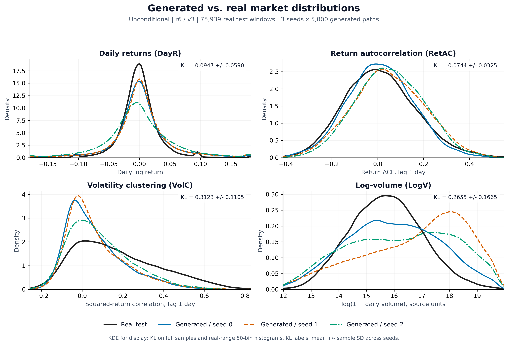
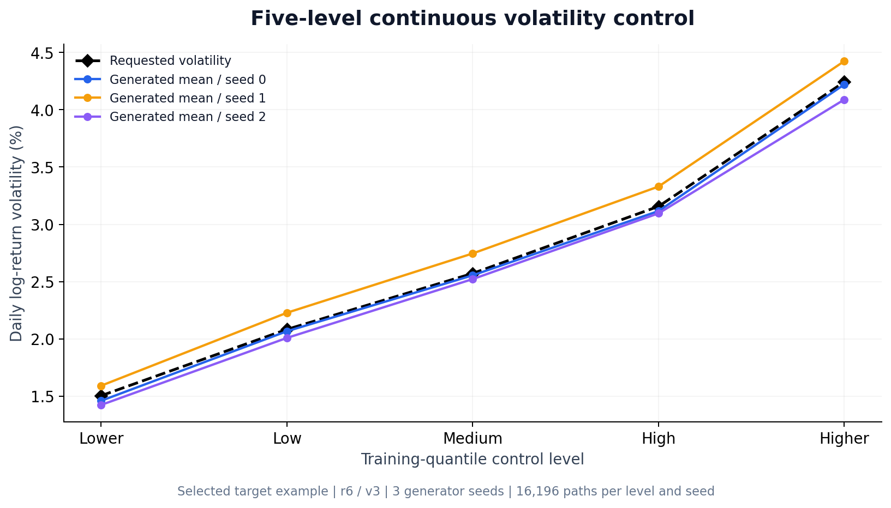
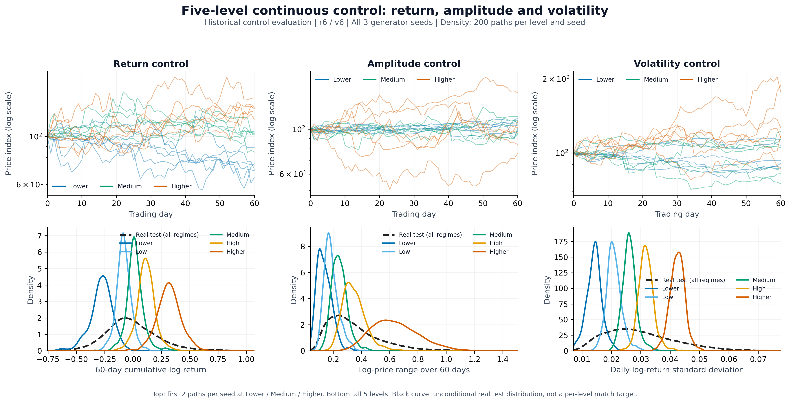
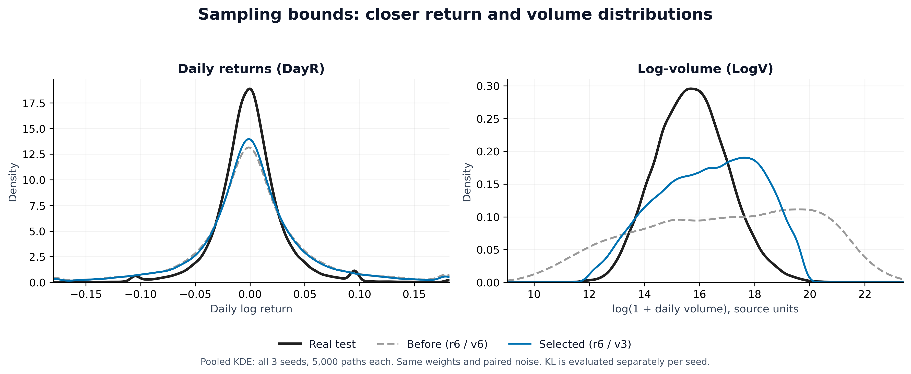
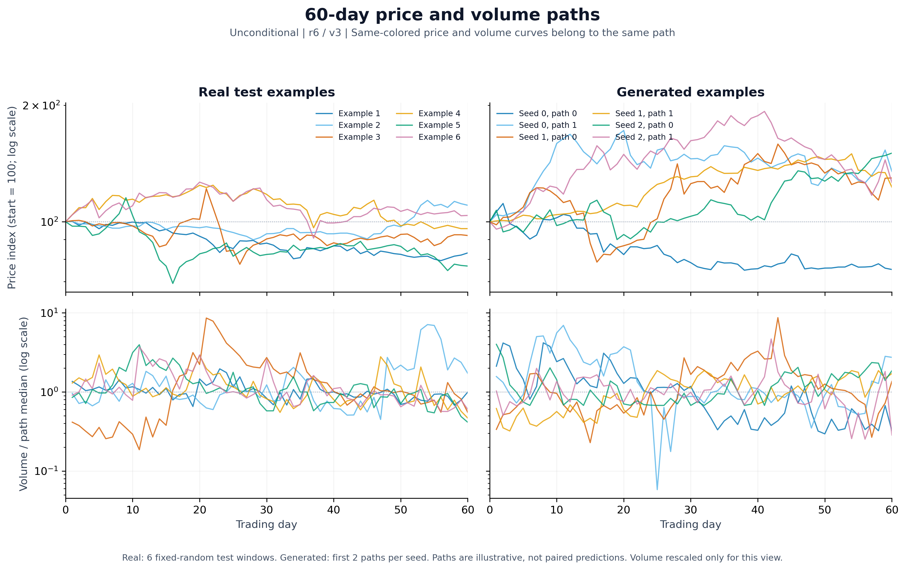

# 生成质量、条件控制与采样改进

本页记录 README 展示结果的统计口径与来源。所有数字和路径图均来自已完成的2015—2024日频实验；本次仅重绘图文，没有重新训练模型。源码、配置与图片公开，原始行情、生成数组与权重留在本地。

## 1. 生成数据与真实数据的相似性

采用论文 Figure 4 / Table 2 风格的分布比较。当前选定配置为对数成交量、收益边界±6、成交量边界±3；使用三个已训练无条件模型的 last 权重，每种子采样5,000条60日路径，DDIM20步、bf16、batch64、CFG0。

真实参照为75,939个测试窗口，对应2023-07-03—2024-12-31测试区间；完整数据区间为2015—2024。相邻同股窗口可以重叠，真实分布按窗口汇总，并非去重后的股票日分布。

| 特征 | 定义 | KL，均值 ± 样本标准差 |
|---|---|---:|
| DayR | 展平后的每日对数收益 | 0.094677 ± 0.059023 |
| RetAC | 每条60日路径的收益lag1自相关，沿用官方分母口径 | 0.074415 ± 0.032497 |
| VolC | 每条路径的平方收益lag1相关性，衡量波动聚集 | 0.312267 ± 0.110463 |
| LogV | 展平后的log1p日成交量；不是订单不平衡率OIR | 0.265468 ± 0.166464 |

每个种子独立计算真实→生成KL，再取三个种子的均值与样本标准差（ddof=1）。使用真实全范围的50个等宽箱，生成密度加1e-9，自然对数。真实范围外的生成值按上游直方图口径不进入箱内密度，其比例另行核验；此处当前配置的四项范围外比例均为0。均值±标准差不是置信区间，也未作显著性检验。

密度图显示，日收益中心形状与收益自相关分布已有较多重合；生成收益仍更分散。LogV分布较原边界明显收窄，但部分种子的峰值偏向较大成交量，跨种子差异仍明显。VolC分布过度集中在零附近，尚未充分复现真实市场的波动聚集。

这些结果检验部分边际和lag1统计特征，尚不构成完整量价联合分布一致的证据，也没有与外部生成模型作排名比较。

## 2. 新裁剪配置的连续波动率示例

- 使用训练种子0/1/2的连续波动率模型、收益6/成交量3。
- 每档每种子16,196条路径，三个种子全部保留。
- 目标为训练期各箱波动率中位数，CFG在相同裁剪下只用验证期目标重新选择。
- 图中展示目标与三个种子的生成均值；纵轴为日对数收益标准差的百分比值。

这是当前配置的大样本波动率控制结果，收益与振幅的历史三模型对照另列于下节。

## 3. 历史条件控制对照（共同±6，单独标注）

原报告的控制实验使用两个通道共同±6、每目标每档每方法200条路径；各目标分别训练。连续模型输入训练箱中位数，离散模型输入档位，无控制模型不接受行情条件。CFG只在验证期选择。

上排为每种子每档前2条路径，展示Lower/Medium/Higher；下排五档密度均使用三个种子的全部600条路径。黑色虚线代表全部真实测试行情的目标分布，而不是对应档位的真实条件分布。此图说明控制不同目标能改变行情特征；单档密度集中于指定目标附近，并不要求与全部真实行情重合。

三个目标的训练箱中位数为：

| 目标 | Lower | Low | Medium | High | Higher |
|---|---:|---:|---:|---:|---:|
| 60日累计对数收益 | -0.249858 | -0.106768 | -0.018018 | 0.076796 | 0.258666 |
| 累计对数路径振幅 | 0.138344 | 0.204645 | 0.267532 | 0.349544 | 0.522628 |
| 日对数收益标准差 | 0.015040 | 0.020831 | 0.025718 | 0.031569 | 0.042432 |

控制MSE先逐种子计算，再汇总为均值±样本标准差。MSE同时反映生成均值偏离与样本离散程度。不同目标单位不同，不跨行比较大小。

**收益：原始MSE**

| 方法 | Lower | Low | Medium | High | Higher |
|---|---:|---:|---:|---:|---:|
| 无控制 | 0.340011 ± 0.162687 | 0.253844 ± 0.106378 | 0.220976 ± 0.071623 | 0.203266 ± 0.035165 | 0.219616 ± 0.040256 |
| 离散 | 0.123107 ± 0.079690 | 0.008389 ± 0.004546 | 0.006710 ± 0.001042 | 0.011210 ± 0.006755 | 0.208643 ± 0.121994 |
| 连续 | 0.010555 ± 0.005682 | 0.004541 ± 0.000421 | 0.006740 ± 0.002817 | 0.008338 ± 0.002391 | 0.014042 ± 0.001383 |

**振幅：原始MSE**

| 方法 | Lower | Low | Medium | High | Higher |
|---|---:|---:|---:|---:|---:|
| 无控制 | 0.300157 ± 0.083931 | 0.243381 ± 0.075869 | 0.197653 ± 0.068299 | 0.149901 ± 0.058588 | 0.093276 ± 0.039265 |
| 离散 | 0.003644 ± 0.000313 | 0.003550 ± 0.000182 | 0.004666 ± 0.000245 | 0.013984 ± 0.005391 | 0.307321 ± 0.127940 |
| 连续 | 0.002702 ± 0.000314 | 0.002960 ± 0.000420 | 0.003520 ± 0.000519 | 0.006774 ± 0.002161 | 0.043847 ± 0.014230 |

**波动率：表中均值与标准差均乘以10⁻⁶，得到原始MSE**

| 方法 | Lower | Low | Medium | High | Higher |
|---|---:|---:|---:|---:|---:|
| 无控制 | 1463.360 ± 290.830 | 1095.603 ± 242.316 | 837.460 ± 201.501 | 591.209 ± 152.915 | 315.581 ± 65.773 |
| 离散 | 23.254 ± 3.978 | 13.890 ± 1.453 | 17.392 ± 3.946 | 17.747 ± 5.058 | 467.402 ± 259.718 |
| 连续 | 7.330 ± 3.826 | 6.731 ± 0.677 | 5.519 ± 1.317 | 6.596 ± 0.827 | 6.177 ± 0.748 |

对各目标的五档MSE取平均，再对三个种子取均值：

| 目标 | 无控制 | 离散 | 连续 |
|---|---:|---:|---:|
| 收益，原始MSE | 0.247542 | 0.0716119 | 0.0088433 |
| 振幅，原始MSE | 0.196874 | 0.0666331 | 0.0119605 |
| 波动率，表中数值×10⁻⁶为原始MSE | 860.643 | 107.937 | 6.47052 |

连续控制在15个目标/档位组合中14个优于离散；收益Medium档离散略低。此计数基于跨种子平均MSE，**不是当前6/3配置的离散/连续对比**。用默认6/3重新运行会得到新的结果，不承诺逐值复现历史表。

## 4. 配对裁剪消融

固定三个无条件模型与其权重哈希，每种子每配置5,000条路径，采样噪声及batch64划分配对。只把每步预测干净状态的成交量边界由±6收紧至±3，收益保持±6，DDIM20步等其余设置保持。

| 指标 | 原边界6/6 | 选定边界6/3 |
|---|---:|---:|
| DayR KL | 0.112039 ± 0.060137 | 0.094677 ± 0.059023 |
| RetAC KL | 0.074344 ± 0.019049 | 0.074415 ± 0.032497 |
| VolC KL | 0.244055 ± 0.064640 | 0.312267 ± 0.110463 |
| LogV KL | 0.699003 ± 0.291754 | 0.265468 ± 0.166464 |
| 成交量P99 / 真实P99 | 33.6793 ± 11.2750 | 1.9507 ± 0.1881 |

LogV KL降低约62.02%，DayR KL降低约15.50%；成交量P99比值各种子由20.77—41.60降至1.73—2.07。RetAC基本不变，VolC有所变差，因此改进结论限定于成交量与日收益的边际分布。

这是固定权重下的采样干预，会改变后续去噪轨迹，也会限制尾部支持。选定边界外仍有约0.221%的真实测试成交量上尾、0.131%的下尾；当前约0.40%—1.06%的生成成交量贴上限。阈值是观察测试分布后的探索性选择，不能解释为模型学到了完整真实尾部，或独立样本外确定的最优参数。

## 5. 行情示例与绘图口径

- 无条件行情示例使用当前6/3配置。真实窗口固定以随机种子20261103无放回抽取6条；生成示例固定取三个种子各自的前2条，没有按收益、相似性或视觉效果挑选。
- 价格指数为100×exp(累计对数收益)，起点为100。上下同色曲线属于同一窗口；真实与生成之间没有逐条预测配对。
- 示例中的成交量除以本路径中位数，仅便于展示起伏形态。绝对成交量质量由未经此缩放的LogV分布、KL和P99比值衡量。
- 密度曲线使用Scott带宽的Gaussian KDE；每条曲线最多固定随机抽取40,000个观测用于绘图。横轴覆盖所比较各组的0.1%—99.9%分位范围的并集。KDE用于显示，KL始终由全部样本计算。
- 相似性图保留三个种子的独立曲线；裁剪前后密度图仅为可读性合并三个种子，数值表仍逐种子计算后汇总。

`render_report_figures.py`从本地输入绘图，没有内嵌真实观测或生成序列。可选`--audit _local_checks/figures.json`记录源数组SHA-256、样本数、逐种子KL、控制MSE及示例索引，审计文件被Git忽略。另一个`render_showcase.py`仅从报告汇总值重绘裁剪柱图和波动率均值图。

## 6. 本地报告追溯

原始完整报告与样本保留本地，未修改或覆盖。以下源文件SHA-256固定所引用的结果版本；路径相对研究项目，不包含机器或服务器地址。

| 源文件 | SHA-256 |
|---|---|
| `analysis/clip_ablation_20261031/kl_by_seed.csv` | `d38e56189165b1b859c6eb49dfd84adb3430557d2f8b0a3883125da85b2af6f1` |
| `analysis/clip_ablation_20261031/volume_by_seed.csv` | `bfac87243dc9dac4c080d8266560838f6a885bb18b8a6f5c0d59e07d16cb46b5` |
| `analysis/final_report_20261031/table1_complete_mean_std.csv` | `221c0b062fdf837999799392309c7e4a46f886757b94ac2dcef74a40e460a3e4` |
| `experiments/a2c_full_continuous_20261101/server_backup/outputs/rl/continuous_control_diagnostics.csv` | `27f56913d9f1923043d4f1d67d1ca83e462dad23a547abf3cbf1e35bd318a6e2` |

四项密度图使用原裁剪消融中的`volume3_return6`样本；裁剪前曲线使用原5,000条无条件基准样本。五档控制图使用原实验报告的45个连续条件样本文件，所有种子、目标和档位都保留。绘图输入分别通过对应采样记录、裁剪核验与原93文件清单核对哈希，KL和MSE从原数组重算后与报告核对。
